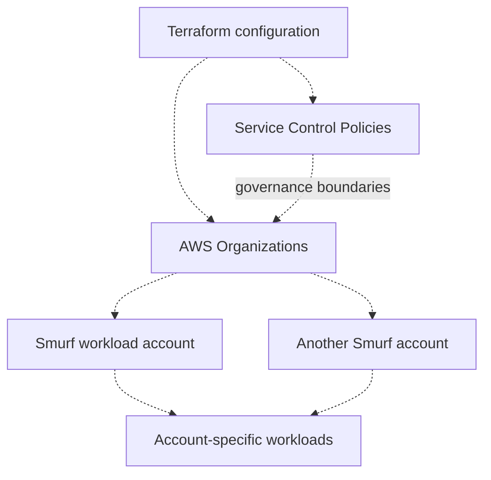

# Smurf Village Cloud Management

A themed learning project for managing multiple AWS accounts with Terraform, AWS Organizations and Service Control Policies.

**Status:** The default branch contains only this README. Infrastructure definitions are proposed in the separate, unmerged initialization PR.

## Proposed governance architecture

Dashed connections show the intended design. This repository's default branch has not implemented or provisioned these components.

## Start here

Review [initialization PR #1](https://github.com/mtzanida/smurf-village-cloud-management/pull/1) and define the account structure and policy requirements before deployment. No Terraform run command applies to the current README-only branch.
